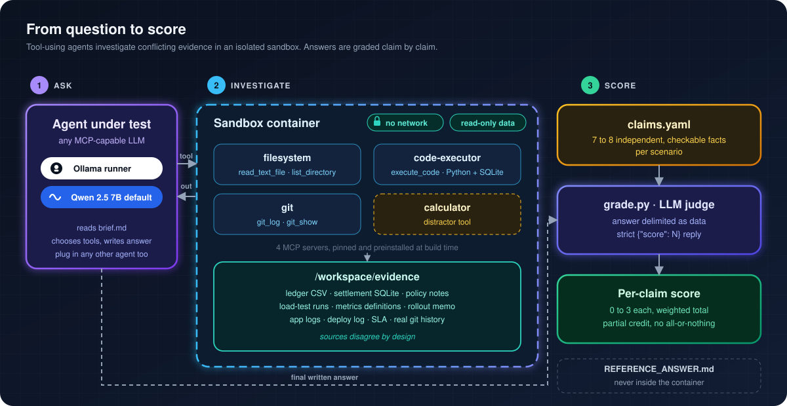

# Multi-Source MCP Benchmark: Tool-Using AI Agents on Conflicting Evidence with MCP, Docker Sandboxes and Claim-Based LLM Grading

A benchmark that tests whether an AI agent can find the right answer when its sources of evidence disagree.

Each scenario gives the agent a business question, a sandboxed Docker container, and files from several sources that contradict each other. The agent uses tools through the Model Context Protocol (MCP) to read the files and run code. It has to decide which source to trust for which fact, reject a wrong but believable explanation, and give a final answer with specific numbers and evidence. The answer is then scored against a list of facts it should contain.

[](https://github.com/anandapurva55/multi-source-mcp-benchmark/actions/workflows/ci.yml)
[](https://github.com/anandapurva55/multi-source-mcp-benchmark/actions/workflows/codeql.yml)


| Scenarios | Evidence files per scenario | Scored claims per scenario | MCP servers | Network inside the sandbox |
| :---: | :---: | :---: | :---: | :---: |
| **3** | **5 to 8** | **7 to 8** | **4** (filesystem, code execution, git, calculator) | **none** |

## Table of contents

1. [Why this exists](#why-this-exists)
2. [Scenarios](#scenarios)
3. [How it works](#how-it-works)
4. [Quickstart](#quickstart)
5. [Design rules](#design-rules)
6. [Implementation details](#implementation-details)
7. [Repository layout](#repository-layout)
8. [Testing](#testing)
9. [Known limitations](#known-limitations)
10. [License](#license)

## Why this exists

An agent usually looks good when it gets one clean source and a clear question, because there is nothing to compare. Real tasks are harder. A ledger and a payment processor report different totals. A memo quotes a test run that was never a fair comparison. The most obvious cause of an outage is not the real cause.

Each scenario here has several such problems, and each problem has a different cause. The agent also gets some tools it does not need. The runner records every tool call, so you can check whether the agent chose sensibly. Tool use is recorded, not scored automatically.

## Scenarios

| Scenario | Decision to make | Problems the agent must find |
| --- | --- | --- |
| [`ledger-drift`](scenarios/ledger-drift) | Which payout total goes into the weekly close report | A payout ledger and a payment processor's settlement export disagree for four reasons: a webhook that was recorded twice, a payment with no ledger entry, a payout made one day after the batch cutoff, and a fee-tier change that was applied to only some payments. |
| [`signal-check`](scenarios/signal-check) | Whether a caching change is released to all servers | A memo quotes two results from load tests whose traffic, hardware, or cache state differ from the baseline. The agent must find the one fair comparison, recompute it from raw samples, and state how uncertain the result is. |
| [`root-cause`](scenarios/root-cause) | What caused an outage and how to prevent it | A circuit-breaker change made just before a traffic increase makes the outage look like the customers' own servers were down. The agent uses logs, a deploy record, a support-queue note, an SLA document, and a real git history. |

## How it works



1. The agent reads `brief.md`, which describes the task.
2. The agent calls MCP tools. Each tool runs inside a Docker container through `docker exec`.
3. The container has no network access, and the evidence files are mounted read-only.
4. The agent writes a final answer.
5. `tools/grade.py` sends each claim in `claims.yaml` and the answer to a judge model. The judge gives each claim a score from 0 to 3. The scores are combined into a weighted total.

## Quickstart

Requires Python 3.11 or newer and Docker.

```bash
pip install -e ".[dev]"

make up SCENARIO=ledger-drift          # build the image and start a clean sandbox; returns when it is ready

# List the tools one MCP server offers inside the sandbox
python tools/mcp_probe.py list-tools \
  --config scenarios/ledger-drift/mcp-servers.json \
  --server filesystem --container msmb-ledger-drift

# Call one tool
python tools/mcp_probe.py call-tool \
  --config scenarios/ledger-drift/mcp-servers.json \
  --server filesystem --container msmb-ledger-drift \
  --tool read_text_file --args '{"path": "/workspace/evidence/settlement_terms.md"}'

make down SCENARIO=ledger-drift
```

### Run a local model

[`tools/run_agent.py`](tools/run_agent.py) runs any [Ollama](https://ollama.com) model on a scenario. It connects to the scenario's MCP tools inside the sandbox, repeats tool calls until the model gives a final answer, and saves that answer to a file. It also saves every tool call (name, arguments, output size, whether the output was cut) to `<out>.trajectory.jsonl`.

```bash
make up SCENARIO=ledger-drift
python tools/run_agent.py --scenario ledger-drift --model llama3.2 --out answer.md
```

Tool results longer than 12,000 characters are cut, and the cut is marked in the text the model sees. Change this with `--max-tool-output`, and the context size with `--num-ctx` (default 32768). You can also use any other MCP-capable agent. Start each server listed in a scenario's `mcp-servers.json` with `docker exec -i msmb-<scenario> <command> <args>` as its stdio transport, and give the agent `brief.md` as the task.

### Grade an answer

```bash
# Check that the claims file and the answer are valid. No API key needed.
python tools/grade.py --claims scenarios/ledger-drift/evaluation/claims.yaml \
  --answer answer.md --dry-run

# Score the answer with any OpenAI-compatible judge endpoint
export MSMB_API_BASE=... MSMB_API_KEY=... MSMB_MODEL=...
python tools/grade.py --claims scenarios/ledger-drift/evaluation/claims.yaml --answer answer.md
```

## Design rules

1. **Evidence states facts, not conclusions.** A document may say what something is, for example what the settlement export is the record of. It never says what to conclude about this case.
2. **Each scenario has several independent problems.** The problems have different kinds of cause: a duplicate record, an unmatched record, a boundary condition, and a rule change that was only partly applied. An agent that stops after the first problem gets partial credit at best.
3. **Every number in a reference answer can be derived from the evidence.** If the evidence cannot explain something, the reference answer says it is unexplained and recommends an investigation.
4. **Every wrong explanation can be disproved with the evidence.** For example, a diff shows that a deploy did not touch the failing code, a hardware table shows that two runs used different machines, or an empty support queue shows that no customer reported an outage.
5. **Trust is assigned per field, not per system.** One source decides whether a record exists. Another decides how it is priced or categorised. The evidence states these rules.
6. **Each claim is a fact that can be checked.** For example: "States the net total as $24,460.80 within $1". This keeps grading easy to audit and allows partial credit.

<details>
<summary><b>Scenario details</b></summary>

**`ledger-drift`** (7 claims). Payout batch from 2027-02-08 to 2027-02-14. The settlement export is the record of whether money moved. The ledger is the record of which order a payout belongs to. The fee schedule is the record of the correct fee rate. The four problems are:

- A webhook retry made the same transfer appear twice (PAY-8801, $1,128.40).
- A $275.00 payment appears in the export but not in the ledger (PAY-9999).
- A payout was made one day after the batch ended (PAY-8841). Its amount matches the ledger, so only the batch changes.
- A seller moved to a lower fee tier during the week, but the ledger applied the new rate to only some payments (PAY-8811, underpaid by $19.20).

The correct total is $24,460.80 across 22 payouts.

**`signal-check`** (8 claims). There are four load-test runs, and only one pair can be compared fairly. The memo's 92% cache hit rate comes from a run with a different traffic profile on different hardware. Its 51 ms latency comes from a run that started with a preloaded cache. On the fair pair, P95 latency improves from 83.0 ms to 75.2 ms and the hit rate improves from 70.8% to 76.0%. Welch's t-statistic is about -6 for latency and +11.5 for hit rate, so the gains are real but modest. One run contains a duplicated sample that must be removed. Each "P95" value is an average of per-minute P95 values, which is not a true P95 for the whole run.

**`root-cause`** (7 claims). Change CB-771 lowered the circuit breaker's failure threshold from 50% to 15% and widened its grouping from per-endpoint to per-region, just before a traffic increase. The agent must:

- Tell apart two error types in the logs (about 6 `circuit_open` errors for each `customer_timeout`).
- Show that an unrelated deploy and the "customer servers were down" theory are wrong.
- Explain why a restart and a scale-up only helped partly.
- Find the later overcorrection to a 90% threshold (CB-772).
- Note that region-level grouping breaks the delivery SLA.

The configuration history is a real git repository. It is stored as a bundle file and cloned into the container when it starts. The logs name each config change only by its commit id, so the agent must run `git show` to see what changed.

</details>

## Implementation details

- **Isolation.** Containers run with `network_mode: none`, all Linux capabilities dropped, `no-new-privileges`, and limits of 512 processes and 2 GB of memory. `make up` removes any old container first, so one run never sees another run's files. A healthcheck makes `up --wait` return only after setup (virtual environment, config repository clone) has finished. The reference answers are in this public repository, so an agent with network access could download them. The MCP servers are installed into the image at build time at pinned versions and started with `docker exec -i`. The `/workspace/...` paths in `mcp-servers.json` are paths inside the container.
- **Mounted evidence.** One image is used for all scenarios. Each scenario mounts its own `evidence/` folder read-only, so changing a fixture does not need an image rebuild.
- **Generators.** Each scenario has a `solution/generate_evidence.py` script that produces its evidence deterministically. It accepts `--out DIR`. The script is kept in `solution/`, away from the evidence, so the agent cannot read it. CI regenerates the evidence and fails if it differs from the committed files.
- **Git fixture.** The `root-cause` repository is stored as `relay-config.bundle`. A git repository placed inside this repository would be saved as an empty submodule pointer.
- **Grading.** The candidate answer is wrapped in `<candidate_answer>` tags and treated as data. The judge must end its reply with a line like `{"score": 2}`. Any other reply raises an error instead of being scored as 0. With `--dry-run`, the script validates the files without calling a model.

## Repository layout

```
docker/base.Dockerfile      pinned sandbox image with the MCP servers installed
tools/mcp_probe.py          list or call any declared MCP server inside the container
tools/run_agent.py          run an Ollama model on a scenario using its MCP tools
tools/grade.py              score an answer against claims (or validate with --dry-run)
scenarios/<name>/
  brief.md                  the task given to the agent
  mcp-servers.json          tools the agent may use, plus unneeded tools
  environment/              docker-compose.yml and the read-only evidence
  solution/                 generate_evidence.py and REFERENCE_ANSWER.md (never mounted)
  evaluation/claims.yaml    the facts an answer is scored on
```

## Testing

```bash
pytest              # file structure, score parsing, and evidence regeneration
pytest -m docker    # builds the image, starts every declared MCP server in its container, checks there is no network
```

CI runs both commands on every push. The Docker test fails if a policy file names a tool that its server does not provide.

## Known limitations

- The scenarios are synthetic and small. They test reasoning over conflicting evidence, not scale. A strong model may get full marks on some claims, so the per-claim scores are more useful than the total.
- Scoring depends on the judge model. Claims are written as explicit facts to reduce variation. Small local models are poor judges: a 3B model gave partial credit to an answer that found nothing. Use a strong judge, and compare scores only between runs that used the same judge.
- The runner supports Ollama only. It uses one run per scenario at temperature 0, so there is no variance estimate, and the repository has no results table for any model yet. Tool calls are recorded but not scored.
- The `code-executor` tool can run any code inside the container. The container is isolated from the network and the host, but the code can still read the evidence it is meant to analyze.

## License

MIT. See [LICENSE](LICENSE).
